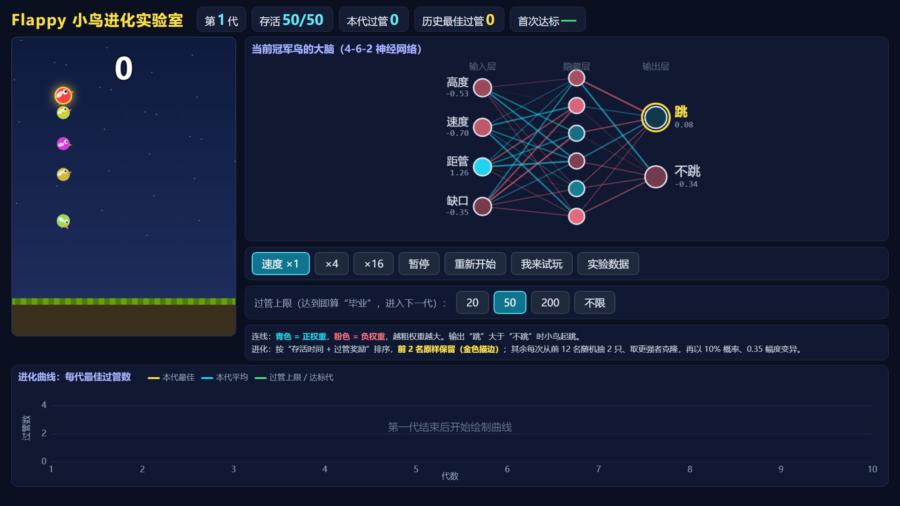
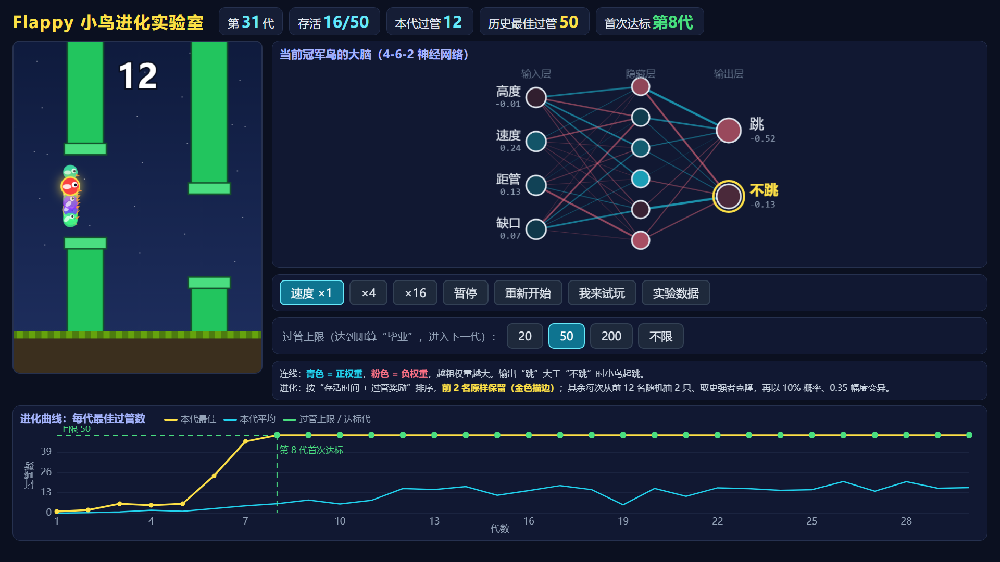
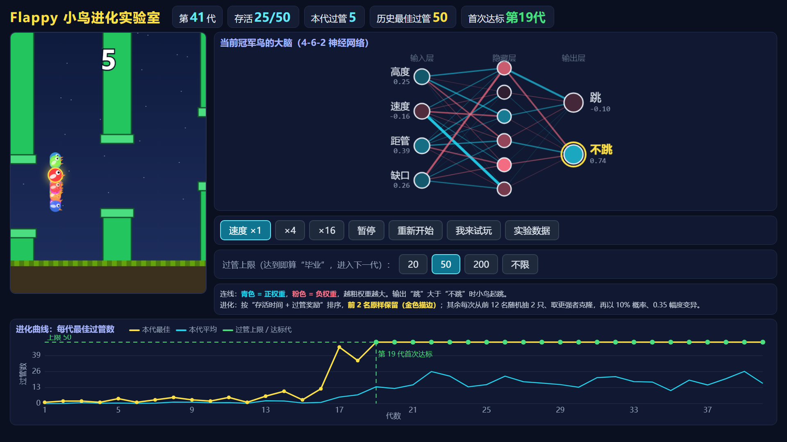

# Flappy 小鸟进化实验室

**在线运行：** https://songyuting92-del.github.io/flappybird-evolution/

50 只小鸟同时玩 Flappy Bird。每只鸟的大脑是一个很小的神经网络，没有人教它们怎么飞，只靠“选择 + 变异”一代代进化。整个项目只有一个 HTML 文件，打开就能运行，不需要安装任何东西。

## 研究问题

只给小鸟一条规则——“活得久、过管多的鸟留下后代”，不告诉它们什么时候该跳，它们能不能学会穿过管道？大概需要多少代？每次实验的结果一样吗？

## 方法

| 项目 | 设置 |
|---|---|
| 种群 | 每代 50 只鸟 |
| 神经网络 | 4-6-2，激活函数 tanh，共 44 个权重（含偏置） |
| 输入（已归一化） | 鸟的高度、鸟的竖直速度、到下一根管道的水平距离、管道缺口中心高度 |
| 输出 | 输出 1 大于输出 2 时跳一下 |
| 适应度 | 存活帧数 + 过管数 × 200 |
| 精英保留 | 前 2 名的基因原样复制到下一代 |
| 选择 | 其余 48 只：每次从前 12 名里随机抽 2 只，取适应度高的那只作为亲本 |
| 变异 | 复制亲本后，每个权重有 10% 的概率加上一个正态随机数 × 0.35 |
| 不使用交叉 | 试过双亲交叉，进化几乎没有进展，所以改成上面这套方案 |
| 首管距离 | 第一根管道约在 200 帧之后出现，让第一代有反应时间 |
| 过管上限 | 本代过管数达到上限（默认 50）就算“毕业”，直接进入下一代；否则要等全部淘汰 |

## 怎么复现

1. 打开上面的在线地址，或者下载 `index.html` 用浏览器打开。
2. 点击 **×16** 加速，大约跑 30～40 代。
3. 点击 **实验数据**：可以查看每一代的记录，也可以导出 CSV（Excel 能直接打开）和 JSON（包含实验参数和每代冠军的 44 个权重）。
4. 点击 **重新开始**，重复几次，比较每次的结果。

因为初始权重和变异都是随机的，每次实验的具体数字会不一样。

## 实验数据

实验数据会放在 [`data/`](data/) 目录下，目前还在采集，完成后补充。

## 结论

待实验数据采集完成后补充。

## 截图说明

`screenshots/` 里的三张图由脚本自动生成：脚本在同一个页面里直接运行模拟，然后用 Edge 无头模式截图。第 2、3 张图挑选的是“首次达标出现在第 6～20 代”的运行，目的是让画面更好看，**仅用于展示界面，不作为实验数据**。

## 关于 AI 辅助

网页代码是在 AI 编程助手的辅助下写成的。研究问题、实验操作、数据采集与分析、结论由作者本人完成。
